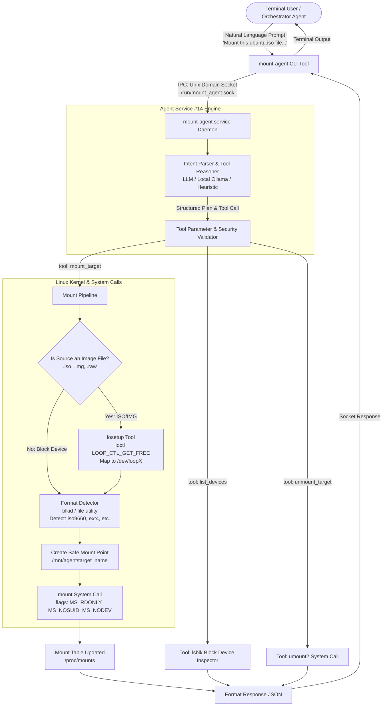

# Project 14: Mount & Partition Agent (Service Architecture)

## 1. System Overview
The **Mount & Partition Agent** is a headless Linux background service designed for Ubuntu/Debian. It replaces complex block-device commands (`lsblk`, `losetup`, `mount`, `umount`, `blkid`) with intuitive natural language prompts executed from the terminal or invoked by parent orchestrator agents among the 35 OS services.

---

## 2. Approach: Developing the Agent as a Service
Developing an agent as a headless OS service (rather than a GUI app) requires addressing privileges, IPC, and safety:

### A. Privilege Separation & Daemon Architecture
- Mounting filesystems and configuring loop devices requires root (`CAP_SYS_ADMIN` and `CAP_MKNOD`).
- To prevent granting arbitrary root shells to users or LLMs, the agent runs as an isolated system daemon (`systemd` service: `mount-agent.service`).
- The daemon listens on a local **Unix Domain Socket** (`/run/mount_agent.sock`).

### B. Inter-Process Communication (IPC)
- Users or other agents invoke a lightweight CLI tool (`mount-agent "Mount ubuntu.iso"`).
- The CLI transmits a JSON message over `/run/mount_agent.sock`.
- The daemon processes the instruction with strict parameters and returns structured execution results.

### C. Tool Isolation & Safety Guardrails
- **Mount Target Isolation:** Temporary mounts are restricted to `/mnt/agent/<image_name>`.
- **Security Flags:** Mounts default to `MS_RDONLY`, `MS_NOSUID`, and `MS_NODEV` to prevent privilege escalation from untrusted disk images.
- **Loopback Cleanup:** If a mount fails, the allocated loop device is automatically freed (`losetup -d`).

---

## 3. Flow Diagram



---

## 4. Header Files & Python Packages

### C Header Files (Linux System Call & Device Level)
| Header File | Purpose |
| :--- | :--- |
| `<sys/mount.h>` | Provides `mount()`, `umount2()`, and flags (`MS_RDONLY`, `MS_NOSUID`, `MS_NODEV`, `MS_NOEXEC`). |
| `<linux/loop.h>` | Loopback device ioctls (`LOOP_SET_FD`, `LOOP_CLR_FD`, `LOOP_CTL_GET_FREE`). |
| `<sys/ioctl.h>` | Low-level device control ioctls for block devices. |
| `<sys/stat.h>` & `<fcntl.h>` | File descriptors, permission modes, and status inspection for images and mount paths. |
| `<libmount/libmount.h>` | High-level mount table manipulation and `/etc/fstab` handling. |
| `<libudev.h>` | Udev device enumeration and partition discovery. |

### Python Packages (Ubuntu / Debian Service)
| Package / Module | Category | Purpose |
| :--- | :--- | :--- |
| `ctypes` | Standard Library | Invokes libc `mount()` and `umount2()` system calls directly without subshells. |
| `socket` | Standard Library | Unix Domain Socket IPC (`AF_UNIX`) between CLI client and root daemon. |
| `subprocess` | Standard Library | Low-level fallback wrappers for `lsblk -J`, `losetup`, and `blkid`. |
| `pyudev` | Third-Party (`apt-get install python3-pyudev`) | Pythonic device monitoring and partition table querying. |
| `pydantic` | Third-Party (`pip install pydantic`) | Strict validation of LLM tool parameters. |
| `ollama` / `requests` | Third-Party | Local LLM inference engine connectivity (Ollama / Llama-3). |
| `systemd-python` | Optional (`apt-get install python3-systemd`) | Notifying systemd watchdog and writing structured journal logs. |

---

## 5. Step-by-Step Flow Explanation
1. **User Input:** The user runs `mount-agent "Mount this ubuntu.iso file so I can look at the files inside."` from the terminal.
2. **IPC Dispatch:** The CLI client connects to the Unix Domain Socket at `/run/mount_agent.sock` and transfers the payload.
3. **Intent Parsing & Tool Selection:** The agent uses an LLM (or deterministic fallback) to recognize that `ubuntu.iso` is a disk image, which requires `mount_target` with read-only flags.
4. **Loopback Allocation:** The agent determines `ubuntu.iso` is a regular file, not a physical partition. It calls `losetup --find --show --partscan ubuntu.iso`, creating a virtual block device (e.g. `/dev/loop0`).
5. **Format Identification:** The format detection tool runs `blkid` or `file -s` on `/dev/loop0`, identifying the filesystem type as `iso9660`.
6. **Directory Preparation:** A sandboxed mount point is prepared at `/mnt/agent/ubuntu`.
7. **System Call Execution:** The agent issues the Linux `mount()` syscall:
   ```c
   mount("/dev/loop0", "/mnt/agent/ubuntu", "iso9660", MS_RDONLY | MS_NOSUID | MS_NODEV, NULL);
   ```
8. **Feedback:** The daemon records the mount in its registry and transmits confirmation back through the socket to the terminal, detailing the path and filesystem type.
